<!-- Profile README for github.com/Krishna-cell-12  (repo name must be exactly: Krishna-cell-12, public) -->
<!-- All visuals are generated SVGs in /assets. To edit text/colours: change build_assets.py, then run `python build_assets.py` -->


 




<!-- TODO: replace the tab link below with each project's real repo URL, e.g. https://github.com/Krishna-cell-12/NexusGuard-AI -->
<a href="https://github.com/Krishna-cell-12?tab=repositories"></a>
<a href="https://github.com/Krishna-cell-12?tab=repositories"></a>
<a href="https://github.com/Krishna-cell-12?tab=repositories"></a>
<a href="https://github.com/Krishna-cell-12?tab=repositories"></a>




